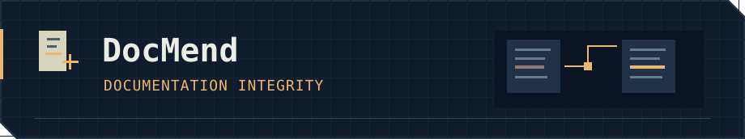

<picture>
  <source media="(prefers-reduced-motion: reduce)" srcset="assets/ai-workspace.png">
  
</picture>

Building retrieval and agent-evaluation tools with inspectable sources, evidence-linked findings and reproducible checks.

[Portfolio](https://nymav.github.io/ny-portfolio/) · [LinkedIn](https://www.linkedin.com/in/nikhil-yarra/) · [Email](mailto:nikhilyarra.mail@gmail.com)

## Projects

Documentation search with inspectable sources, hybrid retrieval and optional cited draft answers. [Provider-validation notes](https://github.com/nymav/docatlas/blob/main/docs/LIVE_PROVIDER_VALIDATION.md).

Analyzes documentation drift across Git revisions, links findings to evidence and guards narrowly scoped repairs. [Implementation and validation](https://github.com/nymav/docmend/blob/main/docs/OFFLINE-MODULE-VALIDATION.md).

Compares candidate prompts or models with a pinned baseline, preserving paired outcomes, regression reports and immutable run history. [Evaluation scope](https://github.com/nymav/modelguard#run-the-included-demonstration).

DocMend and ModelGuard are locally validated pilots. Live-provider and independently reviewed real-world evaluation remain pending; synthetic demonstrations are not production accuracy claims.

<h2></h2>

- [**Tool-Observation Integrity in AI Agents: A Critical Survey of Validation, Provenance, and Execution Assurance**](https://doi.org/10.2139/ssrn.7545819) — SSRN. Validation, provenance and execution assurance in tool-using agents.
- [**Simulator Update Frequency Sensitivity in Driving Scenario Search**](https://doi.org/10.5281/zenodo.23817382) — Zenodo. Simulator update frequency as an evaluation sensitivity variable.

<h2></h2>

- **[GlassPDF](https://github.com/nymav/glasspdf):** local PDF organisation, extraction and English OCR. [Open the app](https://nymav.github.io/glasspdf/).
- **[Mailayer](https://github.com/nymav/mailayer):** read-only Gmail analysis, local search and optional local-model assistance.
- **[DRAX TBS](https://github.com/nymav/drax_tbs):** textbook retrieval with vector search and local-model inference.

<h2></h2>

Python · SQL · FastAPI · SQLite · Git · Docker · GitHub Actions · React

**M.S. Data Science**, New Jersey Institute of Technology 
**B.Tech Computer Science & Engineering**, GITAM
