<a href="https://nymav.github.io/ny-portfolio/"><b>Portfolio</b></a> · <a href="https://www.linkedin.com/in/nikhil-yarra/"><b>LinkedIn</b></a> · <a href="https://teyrinlabs.com"><b>Teyrin</b></a> · <a href="mailto:nikhilyarra.mail@gmail.com"><b>Email</b></a>

<a href="https://github.com/nymav/docatlas"></a>
<a href="https://github.com/nymav/docmend"></a>
<a href="https://github.com/nymav/modelguard"></a>

Case notes: <a href="https://github.com/nymav/docatlas/blob/main/docs/LIVE_PROVIDER_VALIDATION.md">DocAtlas provider validation</a> · <a href="https://github.com/nymav/docmend/blob/main/docs/OFFLINE-MODULE-VALIDATION.md">DocMend validation</a> · <a href="https://github.com/nymav/modelguard#run-the-included-demonstration">ModelGuard demo scope</a>. DocMend and ModelGuard are validated locally on synthetic and offline data; live and independent evaluation are still to come.

<a href="https://doi.org/10.2139/ssrn.7545819"></a>
<a href="https://doi.org/10.5281/zenodo.23817382"></a>

<a href="https://nymav.github.io/glasspdf/"></a>
<a href="https://github.com/nymav/mailayer"></a>
<a href="https://github.com/nymav/drax_tbs"></a>


